# Phase 3 - Experimental Lab

In this lab, I tested how Linux pipes, FIFOs, and processes work.

## Before Starting

The code compiled without errors or warnings. I also checked that no old processes or FIFO files were left.

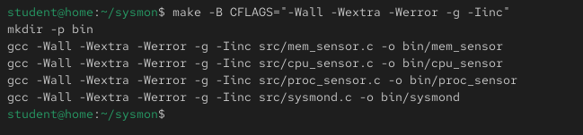

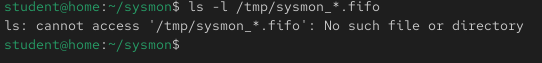

## Experiment 1 - File Descriptors

**1A.** `mem_sensor` received FD `4`.

`sysmond` FD `3` and `mem_sensor` FD `4` both used `pipe:[673381]`. This means they shared the same pipe.

**1B.** `cpu_sensor` did not have this pipe open. If it kept the write end open, `sysmond` would not receive EOF when `mem_sensor` stopped.

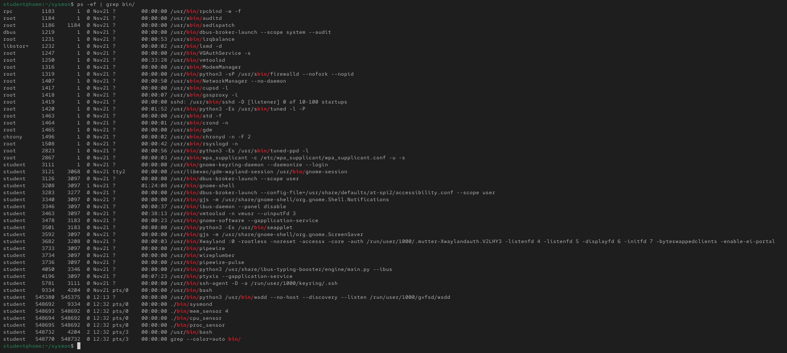

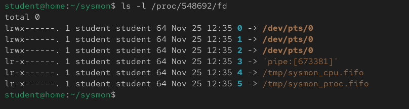

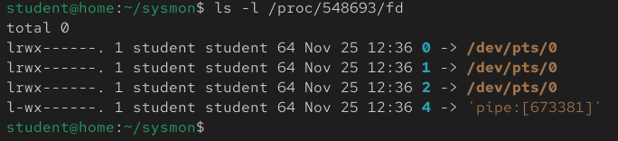

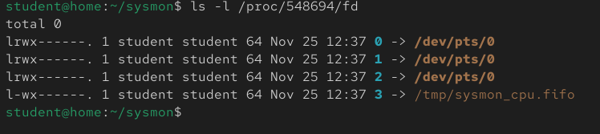

## Experiment 2 - Blocking

**2A.** I disabled `cpu_sensor`. `sysmond` stopped at `open(CPU_FIFO_PATH, O_RDONLY)` because it was waiting for a writer.

WCHAN showed `wait_for_partner`.

**2B.** `mem_sensor` was sleeping between writes. `proc_sensor` was waiting for a FIFO reader. Both showed state `S`.

**2C.** The pipe size in the question is 65,536 bytes, and each memory message is 40 bytes.

`65536 / 40 = 1638`

So it can hold about 1638 messages, or about **27 minutes** at one message per second.

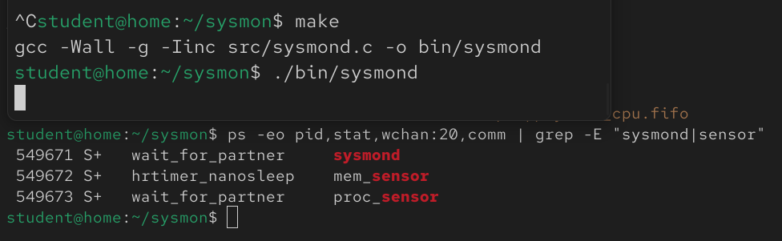

## Experiment 3 - EOF and SIGPIPE

**Part A:** I killed `proc_sensor`. `sysmond` received EOF (`read()` returned 0) and stopped.

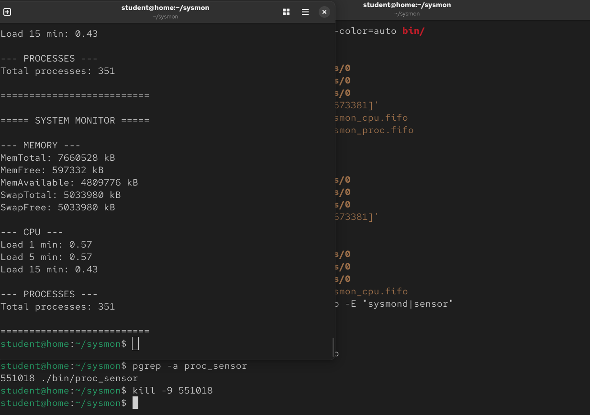

**Part B:** I killed `sysmond`. `mem_sensor` tried to write to a pipe with no reader.

`strace` showed `EPIPE` and `SIGPIPE`.

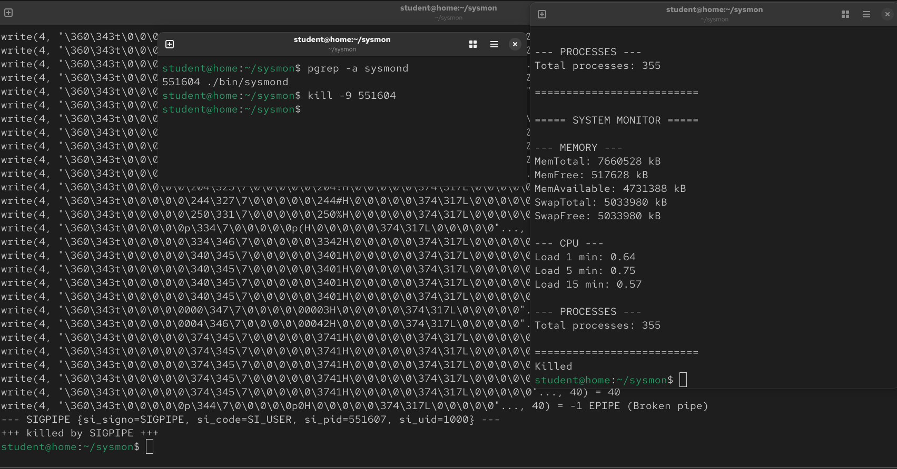

The FIFO files stayed because `kill -9` stopped the program without cleanup. The normal pipe disappeared when it was no longer open.

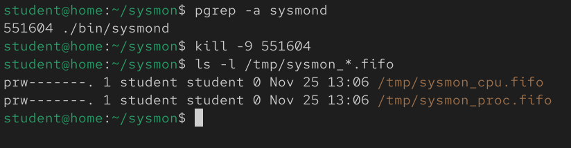

## Experiment 4 - Zombie Process

I stopped `cpu_sensor` using `SIGTERM`.

A Zombie is a finished process that its parent has not collected yet.

Linux keeps its PID and exit status until the parent calls `waitpid()`.

In my test, `sysmond` cleaned up quickly, so I did not see a Zombie.

No processes or FIFO files were left.

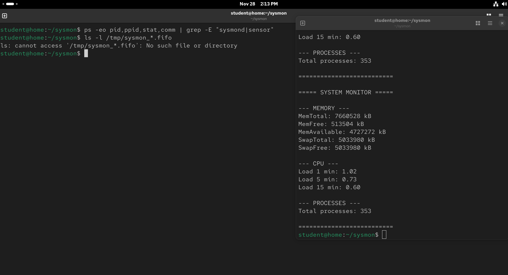
